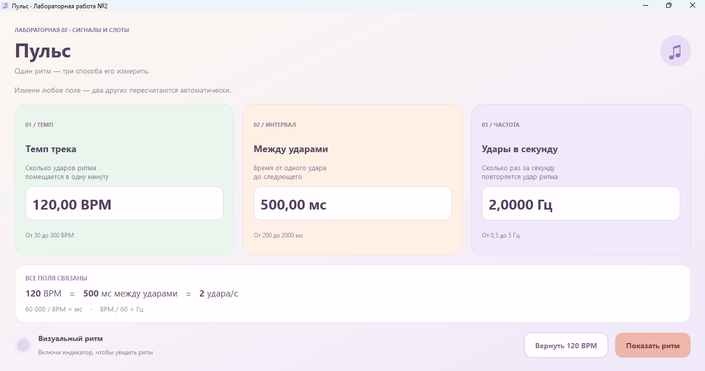
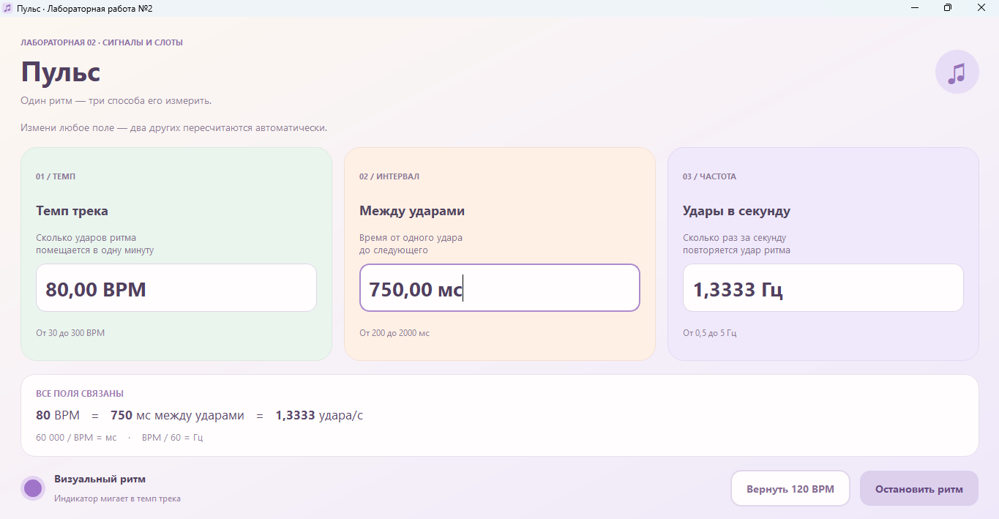

# Лабораторная работа №2

**Курс:** Основы проектирования графического интерфейса компьютерных систем  
**Студент:** 6233-010402D Асташин С.В.

## Описание

Приложение на Python и PyQt5 для пересчёта музыкального темпа.
В окне находятся три связанных поля:

- **BPM** — количество ударов в минуту;
- **мс** — интервал между ударами;
- **Гц** — количество ударов в секунду.

При изменении любого поля остальные пересчитываются автоматически.

Кнопка «Показать ритм» включает мигающий индикатор с выбранным темпом.
Кнопка «Вернуть 120 BPM» восстанавливает исходные значения.

## Запуск

Используется общее окружение `.venv` с установленным PyQt5.
Все команды выполняются из корня проекта.

На Windows:

```powershell
.\.venv\Scripts\python.exe lab2\main.py
```

На Linux/macOS:

```bash
.venv/bin/python lab2/main.py
```

Для запуска через F5 выберите конфигурацию
«Лабораторная работа №2 — Пульс».

## Примеры работы

### Начальное состояние

При запуске установлены значения: 120 BPM, 500 мс между ударами и 2 Гц.



### Автоматический пересчёт

После изменения интервала на 750 мс программа устанавливает темп
80 BPM и частоту 1,3333 Гц. Включённый индикатор мигает с этим темпом.



## Как работает программа

Взаимодействие между объектами реализовано через сигналы и слоты PyQt5.

1. Пользователь изменяет число в поле `QDoubleSpinBox`.
2. Класс `ValueField` отправляет сигнал `valueEdited` с новым значением.
3. Слот `Data.set_value()` пересчитывает остальные величины.
4. Модель отправляет сигнал `valuesChanged` с результатами.
5. Слот `MainWindow.sync_fields()` обновляет поля окна.

Для объявления сигналов используется `pyqtSignal`, для их отправки —
`emit()`, а для подключения обработчиков — `connect()`.
Слоты отмечены декоратором `@pyqtSlot`.

При программном обновлении полей `QSignalBlocker` временно блокирует
сигналы, чтобы пересчёт не запускался повторно по кругу.
Работу индикатора ритма обеспечивает `QTimer`.


## Документация

- [Сигналы и слоты PyQt5](https://www.riverbankcomputing.com/static/Docs/PyQt5/signals_slots.html)
- [Сигналы и слоты Qt](https://doc.qt.io/qt-6/signalsandslots.html)
